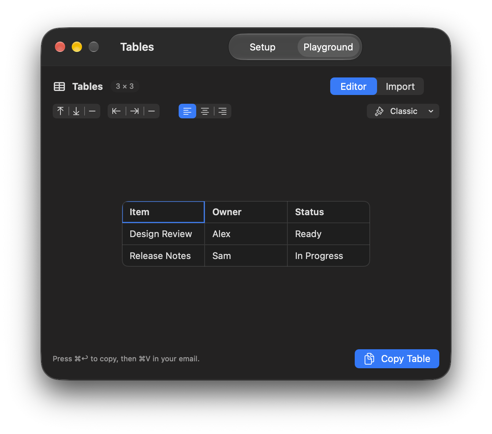
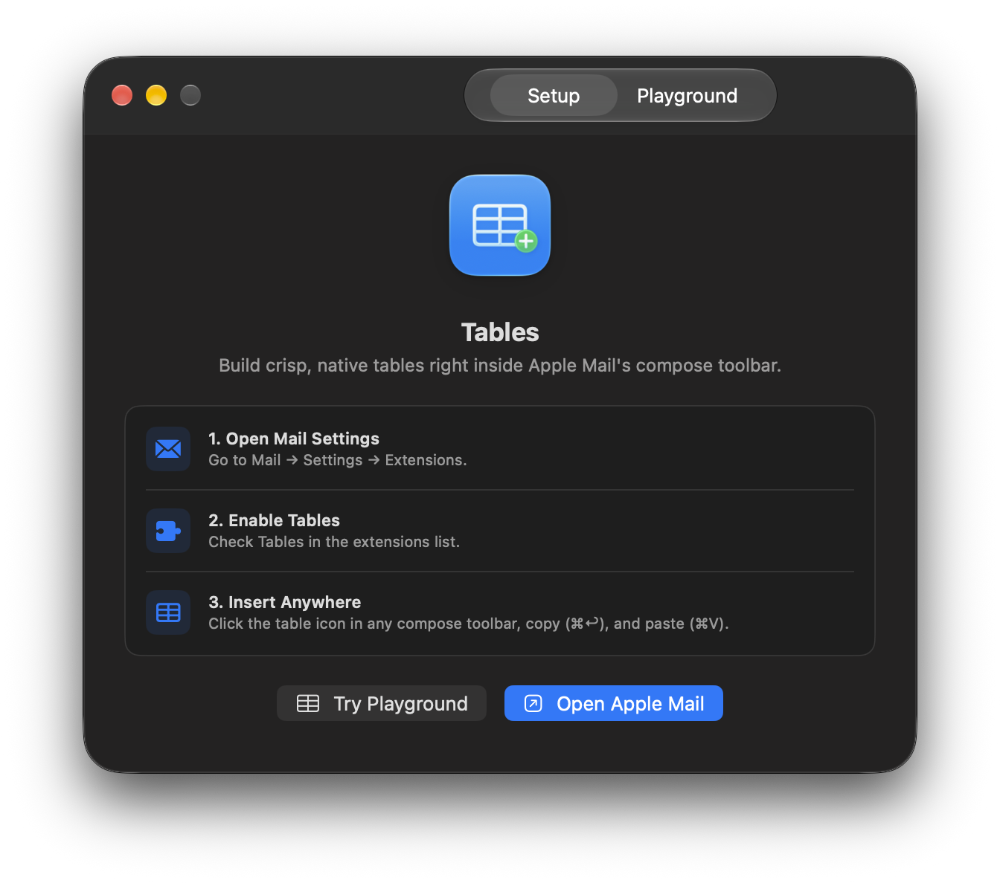

<p align="center">
  
</p>

<h1 align="center">Cellmate</h1>

<p align="center">
  A MailKit compose extension that adds an interactive table builder to Apple Mail's compose toolbar.
</p>

<p align="center">
  
  
</p>

<p align="center">
  
  <br/><br/>
  
</p>

---

## What it does

- **Grid editor:** Add/delete rows and columns, edit cells with `Tab` navigation, and preview header styling, zebra striping, borders, and alignment live.
- **Paste data:** Paste CSV, TSV, or Markdown pipe tables directly into the grid.
- **Insert into Mail:** Press `⌘↩` (or click **Copy Table**) to copy the styled HTML table (with RTF and Markdown fallbacks), then press `⌘V` in your email.

> MailKit extensions are sandboxed and cannot mutate the email DOM directly, so Cellmate uses clipboard copy-and-paste.

## Install

Because MailKit extensions require a trusted code-signing certificate (`pluginkit` rejects ad-hoc signatures), sign locally with a self-signed certificate in Keychain or build with Xcode:

```zsh
brew install xcodegen
xcodegen generate
open Cellmate.xcodeproj
```

Enable **Cellmate** under **Mail → Settings → Extensions**, then click the table button in any compose toolbar.

## Credits

Built with [Google Antigravity](https://antigravity.google) — 100% AI-written code and UI, steered and tested by hand.
